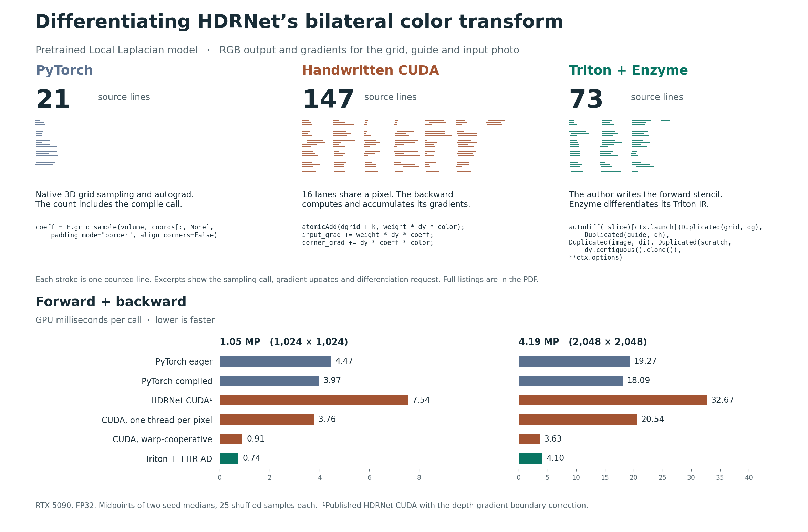

# HDRNet bilateral slicing in PyTorch, CUDA and Triton AD

A trained HDRNet predicts a small grid of 3 × 4 color transforms and a guide value for each image pixel. The slice interpolates eight grid cells, applies the resulting transform to the pixel’s RGB, and produces a new photograph. Training needs derivatives with respect to the grid, the guide and the original RGB. This is the operation used in the Gradient Halide code-comparison figure. We ran it on the authors’ photograph with the grid and guide from their pretrained Local Laplacian model. [Gharbi et al., SIGGRAPH 2017](https://groups.csail.mit.edu/graphics/hdrnet/) · [Li et al., SIGGRAPH 2018](https://people.csail.mit.edu/tzumao/gradient_halide/) · [Original figure](https://people.csail.mit.edu/tzumao/gradient_halide/code_comparison.jpg)



| Implementation | Operator source lines | 1,024² forward + backward | 2,048² forward + backward |
| --- | ---: | ---: | ---: |
| PyTorch eager | 20 | 4.47 ms | 19.27 ms |
| Compiled PyTorch | 21 | 3.97 ms | 18.09 ms |
| HDRNet CUDA, corrected guide derivative | 349 | 7.54 ms | 32.67 ms |
| Handwritten CUDA, one thread per pixel | 123 | 3.76 ms | 20.54 ms |
| Handwritten CUDA, 16 lanes per pixel | 147 | 0.91 ms | **3.63 ms** |
| Triton + TTIR AD | 73 | **0.74 ms** | 4.10 ms |

TTIR AD uses half the source of the fastest handwritten CUDA implementation and runs 5.4× and 4.4× faster than compiled PyTorch. The CUDA schedule matters. Distributing each pixel’s coefficients across lanes brings handwritten CUDA ahead of Triton AD by 0.47 ms at 4 MP. At 1 MP the generated derivative wins by 0.17 ms. The original HDRNet implementation gathers contributions for each grid gradient in a separate kernel. The two newer CUDA implementations accumulate the contributions from each pixel directly. [Full code listings and figure (PDF)](results/bilateral.pdf) · [Source counts and unrounded times](results/comparison.csv) · [CUDA calibration](cuda_warp/calibration.csv)

Each count includes imports, kernel definitions, per-operator launches, argument checks and PyTorch autograd glue. The compiled PyTorch count also includes its compile call. The CUDA counts include the device code and native registration. Data loading, the shared benchmark and compiler implementation are excluded. The figure script checks each listing against cloc 2.10. For the warp-cooperative CUDA implementation it counts the measured source, which also supports the four-lane calibration variant. [PyTorch](torch_impl.py) · [Handwritten CUDA](cuda_warp/kernel.cu) · [Triton](triton_ad.py)

## Where the time goes

The PyTorch implementation uses a native 3D sampler to interpolate 12 affine coefficients per pixel. On the larger image those coefficients occupy 192 MiB before RGB contraction. Compilation reduced backward from 35 kernels to nine. The same native grid-sampling backward consumed 92–94% of compiled backward GPU activity in three profiling traces. The Triton primal interpolates and applies the transform in one tile. Enzyme generates one fused pullback from this code. Three gradient-initialization kernels and a seed copy also run during backward. These traces locate the cost. The timings in the table come from a separate randomized run. [CUPTI traces and breakdown](results/profile/README.md)

## Three guide gradients in the real photograph

Three of the 4,194,304 learned guide values land exactly on a depth-bin center. The original CUDA derivative returned values between −8.57 and +19.15 there across two output cotangents. The derivative of the smoothed interpolation at all three is zero. FP32 rounded a neighbor’s smoothed distance to one, selecting the wrong slope. In the Triton primal we changed how the support of the interpolation is tested before differentiation. The same generated backward then returned zero at all three pixels. The HDRNet CUDA row includes a correction to its handwritten guide-slope test. The original unmodified CUDA has 350 lines. Eager and compiled PyTorch also pass both measured images. A separate stress test finds a residual PyTorch discrepancy immediately adjacent to the first bin center. [Per-pixel derivatives and adjacent-float probes](results/knots/README.md) · [Original CUDA and the correction](cuda/README.md)

## Measurement and reproduction

For each method we checked every output pixel and all three input gradients against a separate FP64 eight-corner implementation, before capture and after replay. The largest relative L2 error on the trained inputs was 4.12 × 10⁻⁶. Every method receives the same nonuniform output cotangent for each seed. Each timing includes forward and all three gradients in a CUDA graph with warmed memory on one RTX 5090. It includes gradient initialization, seed copies and recomputation when the method needs them. We shuffle the six methods each round and take 25 samples per seed. The table uses the midpoint of the two seed medians. Compiling, predicting the grid and guide, decoding the image and Python dispatch are outside the window. A second RTX 5090 ran the separate luminance-guide control. [Primary samples](results/trained/timings.csv) · [Full-image checks](results/trained/accuracy.csv) · [Software and input hashes](results/trained/environment.json) · [Luminance control](results/luminance/timings.csv) · [Odd sizes and a two-image batch](results/odd-batch/accuracy.csv)

First follow the checkpoint extraction instructions. The authors’ 2,048² evaluation guide matched our extracted tensor bit for bit. The two resolutions use the same photograph. [Checkpoint, image and extraction](pretrained/README.md)

Run the commands below from this directory with CUDA PyTorch, nvcc 12.9, the reverse-enabled Triton frontend and its matching Enzyme-JAX extension installed. The measured frontend is `03bead828c` with the synchronized ordinary-store reverse rule. The host used a CUDA 12.9 ptxas on PATH or selected by `TRITON_PTXAS_PATH`. Set `CUDA_HOME` to the toolkit and `TORCH_CUDA_ARCH_LIST=12.0` for the measured GPU.

```sh
mkdir -p /tmp/hdrnet-modules
python cuda/prepare_strict.py /tmp/hdrnet-modules/cuda_strict
export PYTHONPATH="/tmp/hdrnet-modules${PYTHONPATH:+:$PYTHONPATH}"
export TORCHINDUCTOR_COMPILE_THREADS=1
python bench.py /tmp/hdrnet-input.png /tmp/hdrnet-run --trained-inputs /tmp/hdrnet-trained --rounds 25
python bench.py /tmp/hdrnet-input.png /tmp/hdrnet-luminance --rounds 25
python bench.py /tmp/hdrnet-input.png /tmp/hdrnet-tail --batch 2 --sizes 49x67 --grid 7 9 8 --seeds 17 --rounds 5
python plot.py --output /tmp/hdrnet-figures
```

The last command regenerates the figure and table from the archived primary run using Matplotlib and cloc. The historical RGB-specialization control and the numerical probes each have their own reproduction commands.
