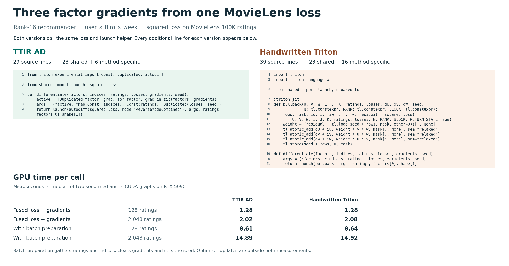

# How much source does a Triton derivative need?

The MovieLens example fits on one page. A training batch predicts each rating from a user, a film and a week factor. The handwritten reverse kernel has to add a contribution to each of their gradient tables, including when two ratings refer to the same row. The generated version passes those tables to `autodiff` and gets all three updates from the loss. Both use the same primal. Across the two seeds, the generated kernel took 1.98–2.05 µs on 2,048 real ratings, versus 2.05–2.11 µs by hand. The operator takes 29 source lines with AD and 39 by hand. [MovieLens figure (PDF)](figures/movielens.pdf) · [Executable comparison](movielens/README.md)



The comparison follows the Gradient Halide figure’s idea of putting source and runtime beside each other. Each colored block shows the entire method-specific implementation. Each PDF prints the shared source on page two. The matched handwritten versions can reuse the same indexing, primal and launch helpers. [Original Halide figure](https://people.csail.mit.edu/tzumao/gradient_halide/code_comparison.jpg) · [Li et al., SIGGRAPH 2018](https://people.csail.mit.edu/tzumao/gradient_halide/)

## Reading the numbers

Source lines are physical Python lines containing code. Imports, decorators, signatures, continuations, activity annotations, scratch buffers, schedules and per-operator launch code all count. Blank lines, comment-only lines and docstrings are excluded. Each implementation pays the full cost of its shared source, including the optional saved-state paths used by the handwritten versions. Framework implementations, data loading, timing and the FP64 oracle are outside the operator count. The CSV also reports a Python-statement count to show how formatting affects the comparison. [Counts](figures/source-counts.csv) · [Counting script](source_lines.py)

The workloads are first-order, dense or contiguous where specified, and run on RTX 5090 hardware. Within each case the exact callables shown in the figure were checked against FP64 and timed on the same inputs with the same requested outputs. GPU timings use CUDA graphs and omit Python dispatch and compilation. Each displayed value is the midpoint of two seed medians. The raw timings and separate checks belong to each example. [Per-seed measurements](figures/seed-medians.csv)

- **MovieLens** measures both the fused loss-and-gradient kernel and the same computation with minibatch preparation. The 2,048 rows come from a full shuffled training batch and 128 rows from the last batch of the same permutation. [Runs and data source](movielens/README.md)
- **GroupNorm** compares two backward implementations of the same one-tile primal. The handwritten tile saves the mean and reciprocal standard deviation. The generated pointer pullback recomputes these values. Upstream Liger provides an additional timing reference for these shapes. The separate optimized by-value experiment has its own implementation and timings. [Code and runtime (PDF)](figures/groupnorm.pdf) · [Runs](groupnorm/README.md) · [By-value experiment](https://github.com/vimarsh6739/triton/pull/16)
- **AdamW** provides the standalone optimizer step, a forward derivative and a reverse derivative. Both implementations share the optimizer update. The figure counts support for both modes and times them separately. [Code and runtime (PDF)](figures/adamw.pdf) · [Runs](adamw/README.md)

## Reproduce

Each example README gives its GPU command, compiler provenance and sample files. To regenerate all the figures and both summary tables from the archived runs, use Python and Matplotlib. From this directory run

```sh
python plot.py --output /tmp/triton-code-figures
```
