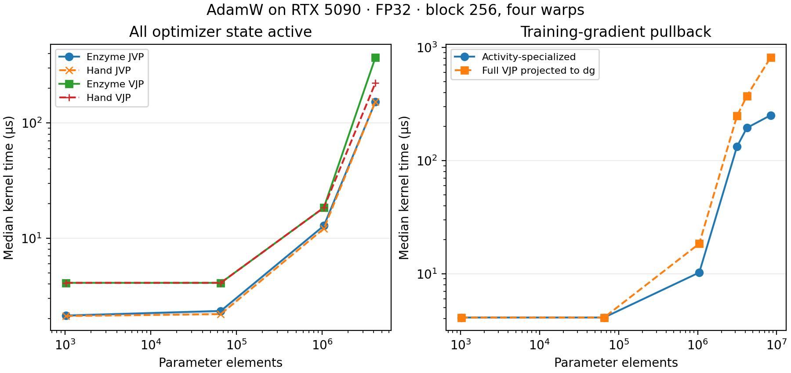

# Differentiating an AdamW update

The fused step reads the parameter, minibatch gradient and two moments. It writes the updated parameter and moments into separate buffers. The hand kernels and Enzyme JVP/VJP have the same output and shadow-buffer semantics. The test checks every output against FP64 PyTorch AD, including accumulation into nonzero initial adjoints and consumption of output seeds.

At 4,194,307 FP32 elements, the best observed Enzyme JVP took 152.45 µs and the best hand JVP took 151.92 µs. The combined VJP took 262.14 µs with Enzyme, 221.18 µs by hand and 229.38 µs when the same hand kernel used atomic additions. Each value is the lowest median across eight launch configurations. These random inputs had strictly positive second moments. NVIDIA global FP32 atomics can flush subnormals. The hand accumulation comparison uses disjoint parameter tiles and tests numerical agreement on the sampled distribution.

For a pullback from the updated parameters to the training gradient, the other arguments can be constant. Marking them constant before AD reduces four TTIR atomic additions to one. At fixed block 256 with four warps, the 4,194,307-element kernel went from 372.74 to 194.56 µs. The repeat with a different seed gave 370.69 to 198.66 µs. Both compute the same observed gradient and all three primal outputs. The full VJP also updates unused adjoints. At 1,023 elements these two variants had the same measured median.

In the full VJP sweep the fastest configuration at 4,194,307 elements was block 1024 with eight warps. Applied without further tuning to 3,145,729 and 8,388,608 elements, it took 188.42 and 663.55 µs. The fixed 256/4 baseline took 251.90 and 825.34 µs. On the larger holdout, 1024/4 was faster still (602.11 µs).



## Reproduce

Use the reverse frontend at `46f4934ff8` and an Enzyme-JAX build containing `a56c4856e` (branch `vim/tritonrev`). This run used an RTX 5090, driver 575.57.08, ptxas 12.9.86, and PyTorch 2.12.0a0+git0d62256. Run from the Triton checkout with the AD build installed.

```sh
export TRITON_PTXAS_PATH=/path/to/cuda-12.9/bin/ptxas
mkdir -p /tmp/adamw-results
cd /tmp/adamw-results
python /path/to/triton/benchmark/bench_adamw.py --csv sweep.csv
python /path/to/triton/benchmark/bench_adamw.py --sizes 3145729 8388608 --blocks 256 1024 --warps 4 8 --seed 67 --repeats 60 --csv holdout.csv
python /path/to/triton/benchmark/bench_adamw.py --modes vjp_g --sizes 1023 65536 1048576 3145729 4194307 8388608 --blocks 256 1024 --warps 4 8 --seed 43 --repeats 60 --csv projection.csv
python /path/to/triton/benchmark/bench_adamw.py --modes vjp_g --sizes 4194307 8388608 --blocks 256 --warps 4 --seed 97 --repeats 60 --csv projection-repeat.csv
gzip *.csv
python /path/to/triton/benchmark/plot_adamw.py .
```

Each sample times one kernel with CUDA event nodes in a graph. Ten graph replays warm the GPU before sampling. The same addresses are reused. Reverse shadow and seed buffers are restored on the stream before the first timing event. Tiny-kernel results include event overhead, with coarsely quantized reverse measurements. The plot shows group medians and interquartile ranges. The raw CSVs preserve individual event times, configuration, TTIR hash, registers, spills and reference error. Pass `--ir-dir PATH` to save the IR during a run.

The update uses the bias corrections for step 32 and fixed AdamW hyperparameters. [AdamW paper](https://arxiv.org/abs/1711.05101)
