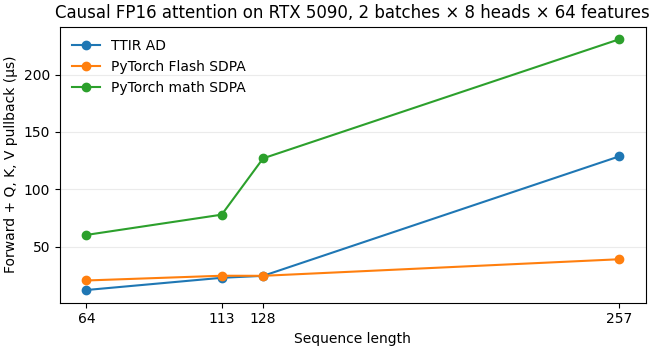

# Reverse-mode causal attention on RTX 5090

We feed an FP16 forward kernel to `triton.experimental.autodiff` and seed its output. A single generated launch writes the forward output and accumulates gradients for queries, keys and values. The online-softmax kernel traverses 32 keys at a time. It masks both sequence tails and future keys. Its only two loop variants share the same step function.

| Sequence length | Generated, µs | PyTorch Flash, µs | PyTorch math, µs | Generated local bytes/thread |
| ---: | ---: | ---: | ---: | ---: |
| 64 | 12.33 | 20.63 | 60.31 | 0 |
| 113 | 22.97 | 24.76 | 77.96 | 736 |
| 128 | 24.66 | 24.69 | 127.01 | 744 |
| 257 | 128.71 | 39.12 | 230.70 | 2,576 |

The table gives the midpoint of two independent seed medians for batch 2, eight heads, head dimension 64, causal FP16 self-attention and no dropout. Each method computes forward and backward. All methods pass elementwise and relative-error checks against forced FP64 math SDPA before timing and after replay. For the generated method, the graph includes zeroing the three gradient buffers and restoring the cotangent that reverse stores consume. PyTorch uses `autograd.grad` and allocates its outputs inside capture. Each median summarizes 25 CUDA-event measurements of 40 graph replays, after warmup. The baseline order reverses for the second seed. These are hot-graph timings on one device. [Timings and quartiles](timing.csv)



At 64 tokens the generated forward and VJP took 60% of the time of forced PyTorch Flash SDPA. At 128 the medians were within 0.2%. At 257 the generated implementation took 3.29 times as long. The recorded kernel used 255 registers per thread in all four cases. Its local storage and dot/atomic counts grew with the number of unrolled blocks. The CUDA local-memory attribute measures allocated bytes. Isolating the latency contribution from spills would require hardware counters. [Compiled kernel attributes and TTIR counts](resources.csv)

## Where the tutorial fails

The original descriptor-based `06-fused-attention.py` produced reverse TTIR for both causal and unmasked attention at length 128. Triton's parser rejected the first `memref.alloc` before TTGIR generation. The causal derivative contains 16 loop-tape allocations across four loops, and the noncausal derivative contains eight across two. Its existing lit check matches dot and descriptor operations in this IR. The tutorial has an unmasked statistic store for every query row, so we tested full tiles.

Using ordinary pointer loads and stores makes it possible to control the loop separately. At 31 tokens, the streaming kernel's one key iteration folds away and the VJP passes. At 33 tokens, the second iteration creates six `memref.alloc` operations. Changing the iterator to `tl.static_range` unrolls the loop before AD. The resulting derivative compiles and passes for sequences with full and partial tiles, including several query CTAs updating the same key and value gradients. A second, dense-tile implementation computes the forward pass without a streaming loop and provides another passing primal for the AD frontend. Neither implementation contains handwritten backward math. [Benchmark source](../../attention_vjp.py)

Across 24 causal/noncausal, tail, seed and length configurations, the maximum relative L2 errors were 0.000499 for dQ, 0.000716 for dK and 0.000682 for dV. The independent mathematical oracle uses FP64 PyTorch SDPA and autograd on the same rounded FP16 inputs. The prefix-cotangent tests also require exactly zero gradients for every future Q, K and V under a causal mask. Every successful generated run checks that the original output cotangent was consumed. The 31-token rolled boundary case adds a 25th configuration. FP16 atomic accumulation can vary slightly between launches. [All per-output errors](checks.csv)

## Reproduce

Install the reverse-mode Triton frontend at `46f4934ff8` and a Triton-enabled Enzyme-JAX at `01e78a9cc`, including the replicated seed-read fix. These measurements used PyTorch commit `0d62256a2b2`, RTX 5090 (SM120), CUDA ptxas 12.9.86, and Enzyme Python extension SHA-256 `4b4d83e438e022fc19d22f007a68700440ea8bf099e3eef01f7d66289af73022`. Use a fresh compiler cache when changing the binding. From the repository root, write to new CSV paths to collect a fresh run.

```sh
for n in 64 113 128 257; do
  for seed in 23 42; do
    python benchmark/attention_vjp.py stream-unrolled --batch 2 --heads 8 --n "$n" --seed "$seed" \
      --timings timing.csv --csv checks.csv --resources resources.csv
  done
done
for case in tile stream-unrolled; do
  for n in 37 113; do
    for mask in --causal --no-causal; do
      python benchmark/attention_vjp.py "$case" --n "$n" "$mask" --seed 105 --csv checks.csv
      python benchmark/attention_vjp.py "$case" --n "$n" "$mask" --seed 105 --prefix-seed --csv checks.csv
    done
  done
done
python benchmark/attention_vjp.py stream-rolled --n 31 --csv checks.csv
python benchmark/plot_attention_vjp.py timing.csv latency.png
```

The following commands reproduce the three parser failures and retain the extracted Enzyme IR under `TMPDIR`.

```sh
python benchmark/attention_vjp.py stream-rolled --n 33 --keep-temps
python benchmark/attention_vjp.py tutorial --causal --keep-temps
python benchmark/attention_vjp.py tutorial --no-causal --keep-temps
```
