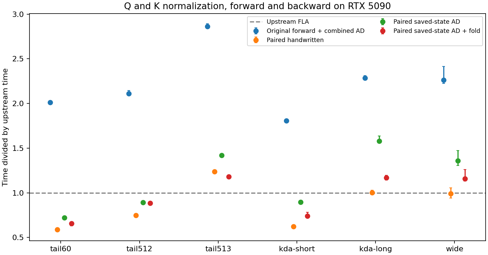

# Generating the normalization pullback used by Kimi Delta Attention

FLA's chunk KDA operator calls an L2 normalizer for Q and K separately. Its backward saves the two normalized outputs and their FP32 reciprocal norms. We compared the two upstream forwards and two handwritten backwards with paired launches that select Q or K using the second grid dimension. The paired forward calls FLA's original block kernel. [Upstream normalization](https://github.com/fla-org/flash-linear-attention/blob/6511ea3ecf7c3b390b15391e670d5bdcb657d914/fla/modules/norm/l2norm.py) · [KDA caller](https://github.com/fla-org/flash-linear-attention/blob/6511ea3ecf7c3b390b15391e670d5bdcb657d914/fla/ops/kda/chunk.py#L195-L204)

| BF16, 16 heads of width 128 | Original FLA | Combined AD | Paired handwritten | Paired saved-state AD | Finite-input AD | With zero-sum fold |
| --- | ---: | ---: | ---: | ---: | ---: | ---: |
| 128 tokens | 4.760 | 8.604 | 2.968 | 4.264 | 3.996 | **3.524** |
| 2,048 tokens | **19.516** | 44.584 | 19.580 | 30.828 | 26.552 | 22.788 |

Values are median microseconds for the two forwards and two input gradients on an RTX 5090, batch one. They cover normalization alone. The optimized generated version was 1.35× faster than the original at short sequence length and 1.17× slower at the longer length. Pairing the unmodified handwritten routines was the fastest short-sequence option. The direct combined VJP differentiates the original FLA kernel, initializes gradient buffers, clones seeds and recomputes the primal. All paired variants use 16 rows per tile and four warps. FLA keeps its own autotuning and switches to one-row kernels above width 512. The 513-wide tail is a case where its dispatch wins. [All six shapes](summary.csv) · [1,476 raw timings](timings.csv)



## How the generated backward uses saved state

Let y = rx, where r = 1/sqrt(sum(x²)+eps). With a local offset u = r·dx the perturbed output in real arithmetic is (y+u)/sqrt(1+sum(u·(2y+u))). This function at u=0 equals y. Enzyme generates its VJP with respect to u, with y and r supplied by FLA's forward. Multiplication by r converts the result to an x gradient. FLA stores y in the activation dtype, so the generated rule follows its rounded-y convention. The caller already owns fresh, non-overlapping input-gradient destinations. Each paired block reads the incoming seed and writes its tile's gradient. No input nor seed copies are required for this backward. This is a normalization-specific saved-state construction.

The finite-input schedule marks multiplications inside the local primal. Specializing u to zero then leaves a floating sum of a dense tensor of positive zeros. The local MLIR matcher verifies the input splat and the exact add-and-return region, then replaces its result with positive zeros of the reduced shape. The KDA-width pullback loses one TTGPU reduction and the emitted PTX goes from 224 to 112 static shuffle instructions and from 17 to zero approximate reciprocal square roots. These counts describe code size, not dynamic instruction counts. The optimization assumes finite data and permits ignoring signed zero for the annotated operations. [Matcher](../../fla_norm/fold.py) · [Transform](../../fla_norm/finite.mlir) · [Instruction counts](instructions.csv)

## Checks and timing

Each case used independent random seeds for Q and K. We set one input row to zero and one near zero. Both outputs, reciprocal norms and VJPs were compared to FP64 autograd on x/sqrt(sum(x²)+eps), including the upstream 60-, 512- and 513-wide shapes. The largest row-relative error across the cases and methods was 0.00233. Input gradient seeds were checked for mutation. [Upstream tests](https://github.com/fla-org/flash-linear-attention/blob/6511ea3ecf7c3b390b15391e670d5bdcb657d914/tests/modules/test_l2norm.py)

Inside `chunk_kda`, the generated version uses a two-output PyTorch autograd function outside the chunk operator and disables its internal normalization. The upstream control enables the original normalization. At 127 tokens/2 heads/64 features and 257 tokens/16 heads/128 features, both produced identical BF16 attention outputs and identical V, gate and beta gradients. The largest Q/K gradient discrepancy was 0.00291 relative L2. This checks dense first-order execution. The separate normalization timing does not measure a full KDA speedup. [KDA values](kda.csv)

The harness captures eight repetitions of each normalization workload per CUDA graph. It chooses a fresh random method order per round, warms five rounds and records 41 CUDA-event samples per method. The final replay outputs are checked again. The inputs and output cotangents remain fixed in device memory. Paired launches use a single fixed schedule across shapes; the comparison includes that schedule choice and the different graph launch counts.

## Reproduce

Use CUDA PyTorch with the reverse Triton frontend and an Enzyme-JAX build containing the reverse rules and the ordinary-store seed fix. The measured environment used RTX 5090, CUDA 12.9, Torch 2.12.0a0+git0d62256, the workspace frontend at 03bead828c and the CLI with SHA-256 37c31c1d1ece67c9418814b4bec7a365cab1a78f89863cdefa8f1bf288e4eb94. The CLI is used to generate the pure tile VJP. The Python extension is used for the combined pointer control. The fold uses the MLIR Python bindings from jaxlib.

```sh
git clone https://github.com/fla-org/flash-linear-attention.git ../flash-linear-attention
git -C ../flash-linear-attention checkout --detach 6511ea3ecf7c3b390b15391e670d5bdcb657d914
# Install FLA's Python dependencies in the benchmark environment.
python -m pip install einops 'transformers>=5.6.2,<6'
export PYTHONPATH="$(realpath ../flash-linear-attention):$PYTHONPATH"
export FLA_CACHE_MODE=disabled
python -m pytest -q benchmark/fla_norm/test_fold.py
python benchmark/fla_norm/bench.py --output /tmp/fla-qk-run --launches 8 --repeats 41 --ir-dir /tmp/fla-qk-ir
python benchmark/fla_norm/kda.py --output /tmp/fla-kda.csv
python benchmark/fla_norm/plot.py /tmp/fla-qk-run/timings.csv /tmp/fla-qk.png
```

The matching normalizer and generated function builder are in [kernels.py](../../fla_norm/kernels.py). The [KDA integration](../../fla_norm/kda.py) changes the Q/K normalization boundary in the benchmark process. Upstream sources stay untouched.
