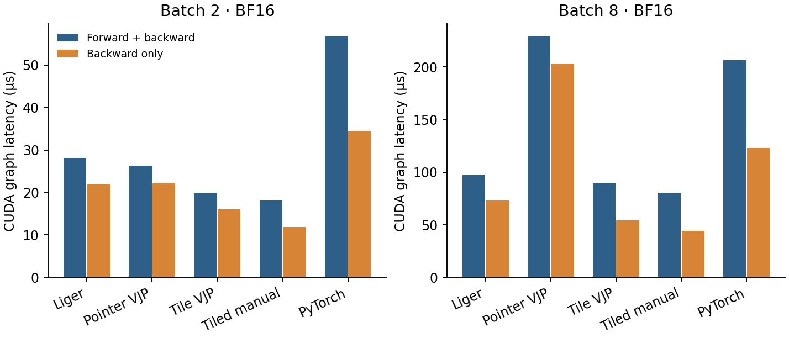

# A generated backward for Liger's GroupNorm benchmark

Liger's GroupNorm backward iterates over the channels in a group twice. The first loop reduces the incoming gradient and the second writes the input gradient. We put all four channels and their 512 spatial positions in one Triton tile, then asked Enzyme for the VJP of the tile's normalized affine function. Each program owns its input-gradient tile and writes it directly. Weight and bias are shared across batches, so their contributions still accumulate atomically. [Original backward](https://github.com/linkedin/Liger-Kernel/blob/cc29eda82744aece335c1ca4bd3ace5c9d768048/src/liger_kernel/ops/group_norm.py#L99-L214) · [Upstream benchmark configuration](https://github.com/linkedin/Liger-Kernel/blob/cc29eda82744aece335c1ca4bd3ace5c9d768048/benchmark/scripts/benchmark_group_norm.py)

At BF16 shape **(2, 4096, 512)** on an RTX 5090, the generated tile VJP took **15.97–16.00 µs** in backward, versus Liger's **21.95–22.05 µs**. The complete forward and backward took **19.84–19.94 µs** versus **28.10–28.13 µs**, about **1.41× faster**. At batch eight, full-call speedup narrowed to **1.08–1.10×**. Each range reports the two independent run medians.

| BF16, batch 2 | Backward only (µs) | Forward + backward (µs) |
| --- | ---: | ---: |
| Upstream Liger | 21.95–22.05 | 28.10–28.13 |
| Triton pointer VJP on our tiled primal | 22.14–22.21 | 26.18–26.34 |
| Enzyme value VJP on the same tiled primal | 15.97–16.00 | 19.84–19.94 |
| Handwritten tiled backward using Liger's saved statistics | 11.78–11.87 | 18.08–18.14 |
| PyTorch GroupNorm | 34.34–34.40 | 56.86–56.90 |



## Eager PyTorch wall time

A second measurement runs ordinary eager forward and autograd calls on an AMD Threadripper PRO 7995WX host. At batch two, the generated tile method took **86.84–90.75 µs** per call versus **142.51–143.48 µs** for Liger. PyTorch's built-in GroupNorm took **78.74–83.60 µs**. At batch eight the three numbers were **96.40–96.87**, **145.08–148.69** and **214.39–215.91 µs** respectively. This measures steady-state throughput with Python dispatch included. Each of 15 shuffled rounds times 32 consecutive calls between device synchronizations. The CUDA graph results above separately measure GPU work. [Raw wall times](eager.csv)

## What changes

The two generated paths share the same Python primal. The ordinary pointer VJP runs the public combined AD launcher during backward. It zeros the input-gradient buffer and clones the seed that the launcher consumes. The value VJP differentiates just the arithmetic on the tile and returns three gradient values. Its wrapper reads the incoming gradient, stores the fresh input gradient, and adds the two shared parameter gradients. This wrapper is specific to the contiguous group layout. It also recomputes the statistics. The handwritten control reuses the upstream forward's saved mean and reciprocal standard deviation, and uses per-channel sums for both the parameter and input gradients. [Primal, handwritten control and harness](../../groupnorm_pullback.py) · [Typed derivative and launch wrapper](../../groupnorm_values.py)

We tested FP32 and BF16, two upstream-shaped inputs and a masked tail with 3 channels per group and 47 spatial elements. Every method checks the output, input gradient, weight gradient and bias gradient against eager FP64 GroupNorm before and after timing. For the value VJP, maximum relative L2 error across these four arrays was below 0.0041 in BF16 and 1.3e-7 in FP32. The inputs are normally distributed, the scale and bias are random and the seed is nonuniform. These controls cover dense first-order training. Liger also supports larger groups that span multiple tiles. This experiment uses one tile per group.

Each CSV contains 51 shuffled CUDA-event samples per case after five warmup rounds. Each sample times a replay of a captured PyTorch graph. Backward-only capture retains the forward activations. The full comparisons include PyTorch-level buffer setup and GPU operations recorded in the graph. GPU timing excludes Python dispatch and compilation. All timings reuse warm memory addresses.

## Reproduce

Use the Triton checkout with the reverse frontend at 46f4934ff8 (or the compatible hooks at 03bead828c), the Enzyme-JAX reverse binding with the seed synchronization fix and Liger at cc29eda82744aece335c1ca4bd3ace5c9d768048. The recorded binding has SHA-256 72451477afb2a5f4cda29409d3e17fa9eb667d62c401fb640f23e9d3cbc2e852. The environment used PyTorch 2.12.0a0+git0d62256, CUDA ptxas 12.9.86 and driver 575.57.08.

From the benchmark directory with Liger's src, the Triton frontend and the compiled binding on PYTHONPATH:

```sh
mkdir groupnorm-run
for scope in full backward; do
  for seed in 51 137; do
    python groupnorm_pullback.py --scope "$scope" --seed "$seed" --out "groupnorm-run/$scope-seed$seed.csv"
  done
done
python groupnorm_eager.py groupnorm-run/eager.csv
python results/groupnorm-sm120/plot.py --samples groupnorm-run --output groupnorm-run/groupnorm.png
```

The plot script defaults to the four archived CSVs beside it. Each benchmark run writes a new CSV.
