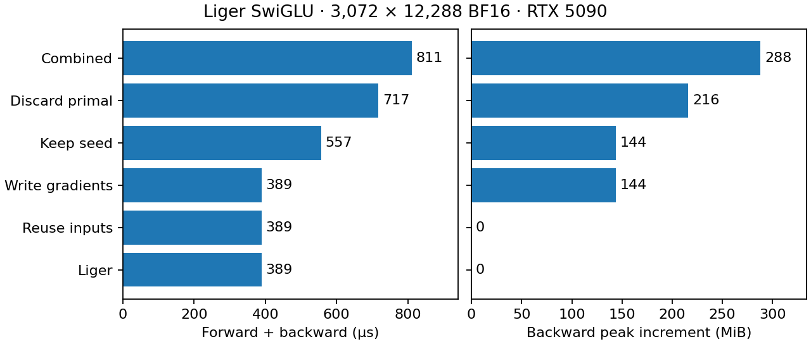

# Where does the SwiGLU backward time go?

On the BF16 3,072 × 12,288 activation from the [Qwen3 shape report](https://github.com/linkedin/Liger-Kernel/issues/1330), writing fresh gradients directly brought generated forward plus backward from 811.01 to 389.12 µs. Liger's handwritten path also took 389.12 µs. Explicit input donation saved 144 MiB of backward allocations at the same measured latency.

| Cumulative change | Full forward + backward (µs) | Incremental backward allocation (MiB) |
| --- | ---: | ---: |
| Original generated VJP | 811.01 | 288 |
| Discard the already returned primal output | 716.80 | 216 |
| Keep the incoming seed read-only | 557.06 | 144 |
| Write each fresh gradient once | 389.12 | 144 |
| Donate both inputs to hold their gradients | 389.12 | 0 |
| Original handwritten Liger | 389.12 | 0 |



The forward and gradient arithmetic come from Liger's [unchanged upstream kernels](https://github.com/linkedin/Liger-Kernel/blob/cc29eda82744aece335c1ca4bd3ace5c9d768048/src/liger_kernel/ops/swiglu.py). Only backward's memory contract changes. The Enzyme-JAX pass erases the dead primal store. A scoped MLIR rewrite checks the generated accesses, drops the seed clear and converts the two relaxed atomic adds to stores when the caller requests freshly produced gradients. Reusing the input storage is optional. The donation case retains a CTA barrier after reading the inputs and seed so all replica warps finish reading the original values before any overwrites.

Liger launches disjoint contiguous row tiles. Within each buffer, every valid coordinate has one owner. The Lean file proves offset injectivity under the stated stride, tile and mask bounds. It includes the integer bounds for the production shape. The adapter checks the Liger ABI, requires matching pointer offset expressions and masks, and accepts an explicit ownership policy. Donation requires disjoint input and seed storage, consumes both activations, and increments their PyTorch version counters. A retained-graph second backward is rejected for donation. The fresh-output variant preserves its inputs and can replay backward. This prototype covers dense aligned local tensors with a default down multiplier and first-order gradients. It uses the actual contiguous indexing of the two pinned kernels. [Address proof](proof/LigerAddresses.lean) · [Ownership and memory checks](../../liger_writeback_checks.py)

The maximum generated-to-Liger gradient differences in the small FP32 and BF16 LigerSwiGLUMLP were 1.11e-7 and 0.00421 relative L2. All 13 activation cases passed FP64 and upstream checks with random Gaussian inputs. Extreme finite negative FP32 inputs expose a separate weakness in the derivative of Liger's decomposed sigmoid. For example, at a = −100 and b = seed = 1, upstream returned zero and the combined VJP returned NaN. The memory transforms preserve this numerical issue. [MLP outputs and all weight gradients](mlp.csv) · [Activation results](summary.csv)

## Reproduce

Use the Liger checkout and reverse-enabled Triton environment documented in [the original experiment](../liger-swiglu/README.md). Set ENZYME_OPT to the Enzyme-JAX executable containing discard-triton-output. The optimizer only transforms the derivative emitted by the synchronized Enzyme Python binding. The benchmark uses 41 shuffled CUDA graph samples per method on RTX 5090. The stored times include forward, backward, seed management and gradient setup. They exclude the restoration of a common input before each measurement. The allocator experiment warms up first, with inputs, output and cotangent live, then takes the difference between peak and starting active PyTorch allocation over one backward. [Raw samples](timings.csv) · [Allocator counters](backward-memory.csv)

```sh
export ENZYME_OPT=/path/to/enzymexlamlir-discard-opt
python benchmark/liger_swiglu.py --modes discard read_seed overwrite donate --samples /tmp/timings.csv
python benchmark/liger_swiglu.py --mlp --modes overwrite donate
python benchmark/liger_writeback_checks.py /tmp/liger-memory
python benchmark/results/liger-writeback/plot.py
lean benchmark/results/liger-writeback/proof/LigerAddresses.lean
```
