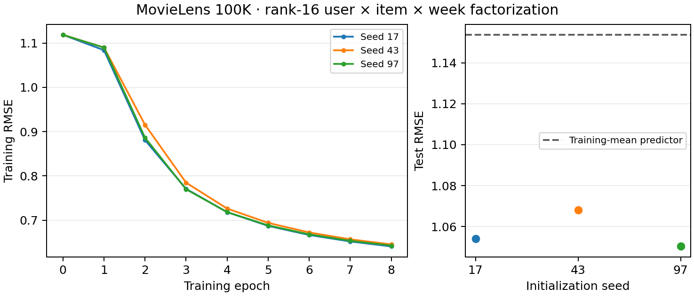

# Training with the generated sparse CP pullback

A rank-16 user × item × week model trained on the 80,000 ratings in MovieLens 100K's official `u1.base` split. At each minibatch the existing `sampled_loss` Triton kernel produces the squared residual losses and all three factor gradients via `autodiff(sampled_loss)`. PyTorch AdamW updates the parameters with those gradients.

On the 20,000 ratings in `u1.test`, final RMSE was **1.0541, 1.0680 and 1.0503** across three initializations. Predicting the training mean of 3.52835 for every example gives **1.1537**. Training RMSE started at 1.119 and ended between 0.641 and 0.645. Before each run, the generated losses and gradients passed an elementwise check against FP64 eager PyTorch on 1,023 training ratings. The largest relative L2 gradient error across the factors and seeds was below 1.71e-7.



The split and eight-epoch budget were fixed before running. Each seed saw the test loss once, at the end. We subtracted the training mean and binned Unix timestamps into seven-day intervals. A time factor initialized near one lets the weeks share a user-item model at the start. All factors were trained with an AdamW learning rate and weight decay of 0.01, minibatches of 2,048, and one warp per Triton program. For 32 test records with a factor absent from training, prediction falls back to the training mean. Results cover one split and a mean-rating baseline. The held-out entries span the same collection period as training.

## Reproduce

Use the one-warp Enzyme/Triton build and GPU configuration in the [sparse CP benchmark](../sparse-cp-sm120/config.json). The archive stays outside the checkout. The script verifies its SHA-256 before reading the two splits.

```sh
curl -fLsS https://files.grouplens.org/datasets/movielens/ml-100k.zip -o /tmp/ml-100k.zip
export TRITON_PTXAS_PATH=/path/to/cuda-12.9/bin/ptxas
python benchmark/sparse_cp_movielens.py /tmp/ml-100k.zip --csv /tmp/movielens.csv
python benchmark/results/movielens-u1/plot.py /tmp/movielens.csv /tmp/movielens.png
```

Repeated rows accumulate floating-point gradients in GPU scheduling order. The recorded training curves can vary slightly even with the same random seed. [Recorded metrics](metrics.csv)

MovieLens 100K was collected by GroupLens at the University of Minnesota. Cite F. Maxwell Harper and Joseph A. Konstan, *The MovieLens Datasets: History and Context* (2015). GroupLens provides the research-use and redistribution terms in its dataset README. [Dataset terms](https://files.grouplens.org/datasets/movielens/ml-100k-README.txt) · [Citation](https://doi.org/10.1145/2827872)
