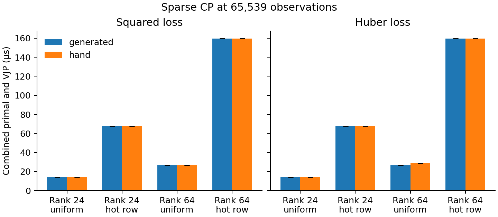

# Differentiating a sampled tensor loss

For each observed triple (i, j, k), the kernel predicts a value from three factor rows and evaluates a squared or Huber loss. `autodiff(sampled_loss)` generates the pullback for all three factors. Several observations can share the same row, so its gradient must accumulate contributions from different GPU programs. The handwritten baseline updates the same buffers, emits the same primal and consumes the same output seed. This is a sampled CP objective. [Kolda and Hong](https://epubs.siam.org/doi/10.1137/19M1266265)

At 65,539 observations and rank 64, the median squared-loss time was 26.62 µs for each implementation with uniform row indices. Making half of the observations share the same row raised both medians to 159.74 µs. Both emitted three TTIR atomic additions. The largest factor-gradient relative L2 error across the sweep was 3.61e-6 against PyTorch FP64 autograd. Each measurement uses a single GPU and a fixed one-warp schedule. A four-warp smoke test of the generated rank-24 pullback gave incorrect gradients and was excluded.



Run from the Triton checkout with its experimental reverse frontend and matching Enzyme-JAX extension. The CSV contains 25 event samples per implementation and configuration. Each timed kernel starts with restored, nonzero gradient buffers and fresh cotangents. Event quantization is visible at the small sizes. The command also writes the generated TTIR.

```bash
python benchmark/sparse_cp.py --output run
python benchmark/results/sparse-cp-sm120/plot.py
```
