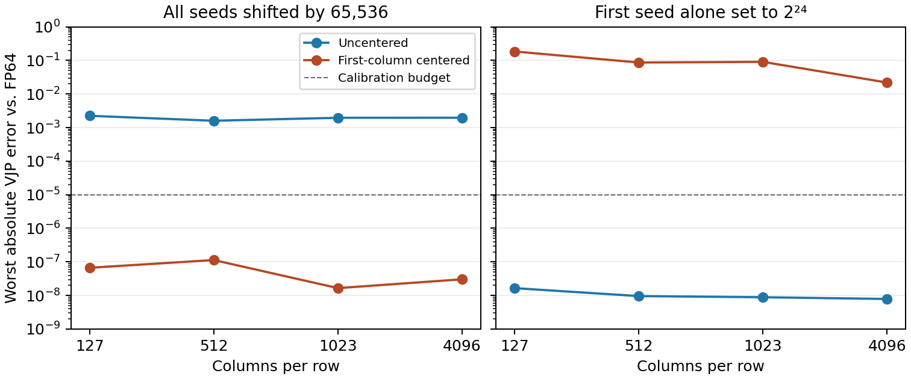

# Centering softmax tangents and cotangents

For a probability row p, the softmax Jacobian J = diag(p) − ppᵀ is symmetric
and J1 = 0. Thus J(v − v₀1) = Jv and Jᵀ(v − v₀1) = Jᵀv in real arithmetic.
The same direction can have very different roundoff after this subtraction.
The Z3 query checks the scalar identity for an arbitrary column given that
the row sums to one.

The experiment differentiates the tensor function in `row.mlir.in` with
Enzyme after detaching the softmax's common logit shift. A typed wrapper
gathers the first valid seed, subtracts it and calls the generated JVP or
VJP. Padded logits are −∞ and padded directions are zero. The VJP adds to
the incoming input adjoint and clears the consumed output cotangent with a
block barrier. Both calls inline into one Triton kernel with three reductions.
The matched control uses the same tensor function and wrapper with the
original seed. The study also times the original pointer-level derivatives.

## RTX 5090 measurements

The cache chose a warp count and schedule on 512 rows under a 10⁻⁵ maximum
absolute error budget on a random seed shifted by +65,536. The table uses
2,048 fresh rows and FP64 references computed from the actual FP32 inputs.
Times are median microseconds per GPU launch over 11 trials of eight graph
nodes, with cotangents restored before each trial.

| Columns | Cached VJP warps | Uncentered error | Centered error | Uncentered µs | Centered µs |
|---:|---:|---:|---:|---:|---:|
| 127 | 1 | 1.95e−3 | 5.89e−8 | 2.768 | 2.704 |
| 512 | 1 | 9.77e−4 | 5.39e−8 | 7.168 | 7.168 |
| 1023 | 4 | 1.95e−3 | 1.66e−8 | 27.648 | 27.648 |
| 4096 | 4 | 1.96e−3 | 3.03e−8 | 132.864 | 132.864 |

Centering qualified at all four widths in both modes. The cache chose it for
all VJPs and for the 127-, 1023-, and 4096-column JVPs. The ordinary JVP won
at 512 columns. Replaying all eight cached choices on another 1,536 rows gave
worst shifted-seed error 9.31e−8. All 1,600 repeated ordinary-seed checks
across calibration, holdout and replay passed.

There is a simple counterexample to always choosing the first column.
Set the first logit to −100 and its seed to 2²⁴, leaving the other logits
and seeds standard normal. That column contributes almost nothing to the
weighted mean. Subtracting its seed from every column rounds away variations
between the other seeds. On 64 independent 127-column rows, the maximum VJP
error grew from 1.66e−8 to 0.184. The additional checks include rows with
alternating ±65,536 offsets, exactly constant seeds and nonzero input adjoints.



## Reproduce

From `benchmark/study`, use a Triton-enabled `enzymexlamlir-opt` that includes
the softmax-shift pass and the synchronized ordinary seed read. The measured
compiler combines Enzyme-JAX commits `e6d5f2e71` and `01e78a9cc`. The
binary digest, CUDA toolkit version and source hashes are in `results/cache.json`.

```sh
python softmax.py --opt "$OPT" --center-seed --max-common-error 1e-5 --output run
python softmax.py --opt "$OPT" --center-seed --max-common-error 1e-5 \
  --replay run/cache.json --holdout-rows 1536 --output replay
python centered/validate.py run run/seed-regimes.csv
python centered/plot.py run vjp-error.png
z3 centered/seed.smt2
```
